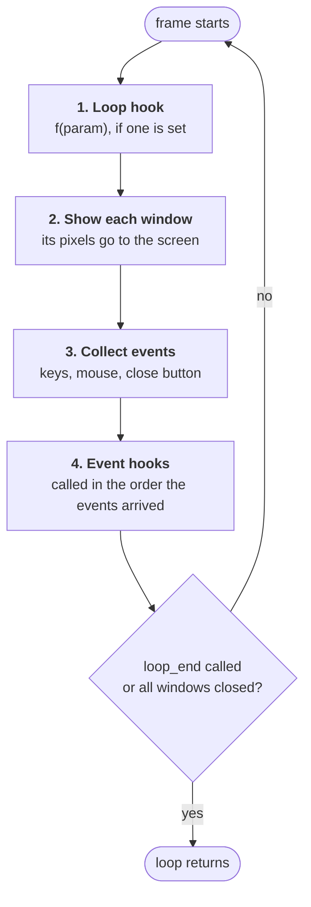

# The main loop

Everything that moves in a malibx program, like animation, input or a game,
runs inside `malibx.loop`. This page explains what happens in each frame, so
you know when your code runs and when its results show up on screen.

## Frames

`loop(mlx)` repeats the same steps, a **frame**, about **60 times a second**
until it's told to stop:



1. **Loop hook.** Your per-frame function, set with `loop_hook`. Do your
   drawing here.
2. **Show.** Each open window's pixels are copied to the screen. malibx waits
   here to keep the loop at 60 fps.
3. **Collect.** Input that happened since the previous frame is turned into
   events.
4. **Event hooks.** Your `key_hook`, `mouse_hook`, `hook` functions and so on
   run.
5. **Check.** If you called `loop_end`, or there's no open window left, `loop`
   returns.

!!! note "What you see is one frame behind your input"
    Event hooks run *after* the window is shown. If a key hook moves a sprite,
    the sprite appears in its new place on the **next** frame, after your loop
    hook has drawn it again. At 60 fps that's 16 ms, too short to notice.
    The thing to take away: **update state in event hooks, draw in the loop
    hook.**

## The loop hook

```python
malibx.loop_hook(mlx, f, param=None)
```

`f(param)` is called at the start of every frame. There's one loop hook per
`mlx`, and calling `loop_hook` again replaces the previous one.

Here's a bouncing square:

```python title="bounce.py" linenums="1"
import malibx

W, H, SIZE = 640, 480, 40

mlx = malibx.init()
win = malibx.new_window(mlx, W, H, "bounce")

state = {"x": 0, "y": 0, "dx": 4, "dy": 3}


def frame(st):
    # 1. update
    st["x"] += st["dx"]
    st["y"] += st["dy"]
    if not 0 <= st["x"] <= W - SIZE:
        st["dx"] = -st["dx"]
    if not 0 <= st["y"] <= H - SIZE:
        st["dy"] = -st["dy"]

    # 2. draw
    malibx.clear_window(mlx, win)                     # (1)!
    for y in range(st["y"], st["y"] + SIZE):
        for x in range(st["x"], st["x"] + SIZE):
            malibx.pixel_put(mlx, win, x, y, 0xB040FF)


malibx.loop_hook(mlx, frame, state)                   # (2)!
malibx.loop(mlx)
```

1. Windows are **not cleared between frames**. Without this line, every
   square you've ever drawn stays on screen and leaves a trail. Try removing it.
2. `state` is passed as `param`, so `frame` receives it as `st`.

!!! tip "Drawing lots of pixels is faster with images"
    `pixel_put` is fine for a few thousand pixels per frame. If you're
    filling most of the window every frame, draw into an
    [image](drawing.md#images) and put the whole image at once.

## Passing state with `param`

Every hook function takes a `param` argument: whatever you passed when
registering it, or `None`. It's MiniLibX's `void *param`. In Python, the usual
choices are:

=== "A dict"

    ```python
    state = {"x": 0, "score": 0}

    def frame(st):
        st["x"] += 1

    malibx.loop_hook(mlx, frame, state)
    ```

=== "A dataclass"

    ```python
    from dataclasses import dataclass, field

    @dataclass
    class Game:
        x: int = 0
        held: set[int] = field(default_factory=set)

    def frame(game: Game):
        game.x += 1

    malibx.loop_hook(mlx, frame, Game())
    ```

=== "A closure (ignore param)"

    ```python
    x = 0

    def frame(_):
        global x
        x += 1

    malibx.loop_hook(mlx, frame)
    ```

Hooks are called with **positional** arguments, `param` last, so you can name
the parameter whatever you like.

## Stopping the loop

`loop` returns when one of these happens:

| Trigger | What happens |
|---|---|
| `malibx.loop_end(mlx)` | `loop` returns at the end of the current frame. Event hooks already queued for that frame still run. |
| The user closes the last window | That window's [close hook (event 17)](input.md#the-close-button) runs, then `loop` returns. |
| [`destroy_window`](../reference/destroy_window.md) on the last window, or [`destroy_display`](../reference/destroy_display.md) | `loop` returns at the end of the current frame. No close hook runs. |
| ++ctrl+c++ in the terminal | `KeyboardInterrupt` is raised from `loop`. |
| A hook raises an exception | The exception propagates out of `loop`, with a normal Python traceback. |

Because hook exceptions aren't swallowed, a bug in a hook stops the program
straight away and shows you where it is. If you want to keep running after an
error, catch it inside the hook.

You can call `loop` again after it returns, for example to show a second
screen. `loop_end` only affects the run that's in progress.

## Timing

malibx caps the loop at 60 fps, but a slow loop hook makes frames slower. If
your animation needs to keep real-world speed when frames are dropped, scale
movement by the elapsed time instead of counting frames:

```python
import time

state = {"x": 0.0, "last": time.perf_counter()}
SPEED = 200  # pixels per second

def frame(st):
    now = time.perf_counter()
    dt = now - st["last"]
    st["last"] = now
    st["x"] += SPEED * dt
```

For simple programs, counting frames (`st["frame"] += 1`) is fine. The
`sprites` example does this.

## Summary

- `loop(mlx)` runs frames at about 60 fps: **loop hook → show → events → event hooks**.
- Draw in the loop hook and change state in event hooks.
- Windows keep their pixels, so `clear_window` (or redraw everything) each frame
  if things move.
- `param` is how state gets into your hooks.
- `loop_end`, closing every window, ++ctrl+c++, or an exception ends the loop.

---

Next: [Drawing :material-arrow-right:](drawing.md)
